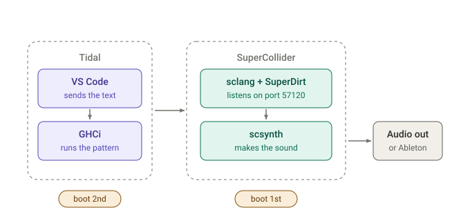

# ambient-lab

A working structure for ambient / drone / noise live-coding with SuperCollider + SuperDirt +
TidalCycles, wired into Ableton Live, with the MicroFreak in the loop.

---

## 1. Who does what (the mental model)

<p align="center">
  
</p>

Two things to read off that diagram:

**Only `scsynth` makes sound.** Everything to its left is instructions in transit. `sclang` and
`scsynth` are separate programs — sclang is the interpreter you type into, scsynth is a C++ audio
engine that only knows "make a voice with these numbers." That split explains the most confusing
failure mode in this stack: SynthDefs registered in sclang while a *different*, freshly booted
scsynth has never been sent them. Symptom is `FAILURE IN SERVER /s_new SynthDef not found`, or
plain silence.

**Boot order runs opposite to signal flow.** Not a package dependency — a network conversation.
SuperDirt has to be listening on port 57120 before Tidal starts talking, and Tidal fires OSC
without ever checking that anyone caught it. Boot backwards and you get silence with no error
anywhere. After that they're independent: restart GHCi freely, but restarting SuperCollider means
re-evaluating the whole startup block, because a fresh scsynth has no SynthDefs.

The full breakdown:

| Layer | Role | You edit it as |
|---|---|---|
| **SuperCollider (`sclang`/`scsynth`)** | The actual DSP. Oscillators, filters, reverbs, granulators. | `SynthDef`s in `sc/` |
| **SuperDirt** | A sample player + event dispatcher + FX bus system living inside SC. Turns incoming OSC events into synth voices on numbered **orbits** (each orbit = its own FX chain and its own audio output bus). | mostly config, in `sc/startup.scd` |
| **TidalCycles** | A Haskell DSL for **patterns of events in cyclic time**. It knows nothing about sound. It sends OSC to SuperDirt. | `.tidal` files in `tidal/` |
| **Ableton Live** | Recorder, arranger, mixer, effects, and host of your existing instruments. The place a *track* becomes a *piece*. | Live set |
| **MicroFreak** | A voice you drive by MIDI, from Tidal or from Live. | MIDI |

**The important honest caveat.** Tidal is superb at *patterns of discrete events*. A drone is not a
pattern of discrete events — it's one continuous voice you slowly deform. You can fake it in Tidal
(very long `sustain`, `slow 16`), and that works well, but the *native* SuperCollider idiom for
drones is **JITLib** (`ProxySpace` / `Ndef`): a named node you re-evaluate live and it crossfades
into the new version over 20 seconds. That is exactly what you want for a bed.

So the recommendation is **both, with a clear division of labour**:

- **ProxySpace** (`sc/beds.scd`) → the continuous drone bed. Hand-deformed, crossfaded, never retriggered.
- **Tidal** (`tidal/sketches/`) → everything with *onsets*: evolving chord changes, noise gestures,
  granular textures, arpeggios, generative harmonic movement.
- **Ableton** → bus processing, arrangement, and your MicroFreak / VSTs.

Don't fight Tidal into being a drone machine. Let it be the thing that makes the drone *change*.

---

## 2. Boot order (every session, in this order)

1. Open **SuperCollider IDE**. Open `sc/startup.scd`. Edit the `~lab` path at the top once.
2. Put the cursor inside the big `(...)` block and press **Ctrl/Cmd+Enter**. Wait for
   `--- ambient-lab ready ---` in the post window.
3. Open your editor for Tidal (**Pulsar**, or **VS Code** + the TidalCycles extension, or
   `vim-tidal`). Open a `.tidal` file. Start Tidal (in Pulsar/VS Code: `Ctrl/Cmd+Shift+P` →
   "Tidal: Boot"). You should see the GHCi banner and `Connected to SuperDirt`.
4. Evaluate `ambient` (the first line of every sketch) to set the slow tempo.
5. Evaluate a pattern block (cursor inside it, `Ctrl/Cmd+Enter`).

`hush` stops all Tidal patterns. `Cmd+.` in SuperCollider is the hard kill for *everything*
including ProxySpace beds.

**One-time install checks**

```bash
cabal list --installed tidal     # should be >= 1.10
```
In SuperCollider: `Language > Quarks` — `SuperDirt` and `Dirt-Samples` must be checked.
Tidal's stable line is 1.10.x (June 2025); the repo moved to `codeberg.org/uzu/tidal`.

---

## 3. Ableton integration — four tiers, adopt in order

Do **not** try to do all of this on day one. Tier 0 for the first two weeks.

### Tier 0 — no Ableton at all
SC talks straight to your audio interface. Learn the language. Record nothing. This is where you
find out what you actually like.

### Tier 1 — SC audio → Ableton, multitrack
`sc/startup.scd` already opens **8 output channels** and maps orbits to separate bus pairs:

| Orbit | Output bus | Intended for | Ableton track |
|---|---|---|---|
| 0 | 0/1 | catch-all / percussive | Mobile 1 |
| 1 | 2/3 | pads & drones (Tidal) | Mobile 2 |
| 2 | 4/5 | noise / washes | Mobile 3 |
| 3 | 6/7 | melodic / glass / arps | Mobile 4 |

ProxySpace beds also `play(out: 2)` etc., so they land on the same buses.

To get those 8 channels into Live you need a **virtual audio device**:

**macOS** (your setup): BlackHole 16ch + a CoreAudio **Aggregate Device**. Full step-by-step in
**`MACOS-SETUP.md`** — the two things that will cost you an hour if you skip them are (a) drag
BlackHole to the *top* of the aggregate device list, or every channel number is offset, and (b)
set your interface as clock source with Drift Correction on BlackHole, or a 20-minute take slowly
falls apart.

Set `s.latency = 0.3` in SC (already done) — generous latency is good for ambient and reduces
dropouts. Increase `s.options.hardwareBufferSize` to 512 or 1024 if you get glitches; nobody hears
latency on a drone.

### Tier 2 — clock sync via Ableton Link
Live is tempo master, Tidal follows.

- **Tidal**: Link is built in since 1.9, but **disabled by default in 1.10**. Find your
  `BootTidal.hs` and uncomment the `streamEnableLink tidal` line. Then enable Link in Live.
- **SuperCollider** (only needed for Link-synced ProxySpace/Patterns):
  `l = LinkClock(1).latency_(Server.default.latency);` then use `l` as your clock.
- Expect to nudge. Link aligns the *shared timeline*, not your two different output latencies.
  Tidal's `oLatency` in `BootTidal.hs` is your trim control; adjust by ear against a click.

For ambient, honestly, you may never need this. Free-running Tidal against a Live set with no grid
is a legitimate and often better choice. Add Link only when you want rhythmic material to lock.

### Tier 3 — Tidal as MIDI sequencer for Live + MicroFreak
This is the highest-leverage integration for you, because it lets Tidal drive sounds you already
know how to design. Uncomment the MIDI block in `sc/startup.scd`:

```supercollider
MIDIClient.init;
~midiOut = MIDIOut.newByName("IAC Driver", "Bus 1");  // macOS; loopMIDI on Windows
~midiOut.latency = 0.02;
~dirt.soundLibrary.addMIDI(\midi, ~midiOut);
```

Then in Tidal:

```haskell
d5 $ slow 8 $ n "<c3'min9'4 gs2'maj7'4>" # s "midi" # midichan 0 # sustain 6
```

Set up **IAC Driver** (macOS: Audio MIDI Setup → MIDI Studio → enable IAC) or **loopMIDI**
(Windows). Point one MIDI channel at a Live track hosting a synth, another channel at the
MicroFreak's MIDI input. The MicroFreak is paraphonic — feed it slow four-note chord voicings and
let its filter and the Cycling Envelope do the evolving.

### Tier 4 — capture and arrange
1. Arm the four Mobile tracks, hit record in Session view, and improvise for 15–20 minutes.
2. Consolidate the good stretches into clips. Ambient is 90% editing.
3. Alternatively render from SC directly: `s.record(numChannels: 8)` … `s.stopRecording`.

Rule of thumb: **improvise long, then arrange.** Don't try to compose in Tidal.

---

## 4. What to actually learn, in what order

**Week 1 — Tidal's core, on boring sounds.**
Ignore drones. Get fluent in: `d1`, `s`, `n`, `#`, `$`, mini-notation (`~ [ ] < > * / , ?`),
`slow`/`fast`, `sometimesBy`, `every`, `superimpose`, `off`, `jux`, `chunk`, `segment`, `range`,
`sine`/`saw`/`perlin`, `hush`. Half an hour a day at the keyboard beats reading docs.
Reference: <https://tidalcycles.org/docs/> and Alex McLean's *Tidal Cycles* patterns pages.

**Week 2 — SuperCollider enough to own your sound.**
`SynthDef`, `EnvGen`/`Env`, `SinOsc`/`VarSaw`/`PinkNoise`, `RLPF`/`BPF`, `LFNoise2`, `Splay`,
`Mix`, `.kr` vs `.ar`. Then modify — don't write from scratch — the synths in `sc/drones.scd`.
Change one number, re-evaluate, listen. Reference: Eli Fieldsteel's SuperCollider tutorial series
is the single best resource in this whole stack.

**Week 3 — the bed.** `ProxySpace`, `fadeTime`, `Ndef`. Build one drone you love and can keep
deforming for 20 minutes. This is where "ambient" actually starts.

**Week 4 — harmony and integration.** Tidal chords (`"c'maj9'5"`), `arp`, `scale`, `rolled`,
`toScale`; then Tier 1 audio routing and one recorded 20-minute take.

Listening homework that maps directly onto this stack: Eliane Radigue (single-drone deformation),
Thomas Köner (noise as harmony), Kali Malone (slow chord change as the entire event), William
Basinski (loop decay), Caterina Barbieri (pattern-as-melody — the most Tidal-shaped of these).

---

## 5. The agent / tooling question

You will want to build this. Resist for about four weeks. The reason is not that it's a bad idea —
it's that you don't yet know which parts are tedious, and tooling built on guesses about your own
workflow is the most reliable way to waste a month. Live-code badly for a while first.

When you do build it, here's a scope that earns its keep, in increasing order of value:

**Phase 1 — plumbing (a weekend).** A `justfile`/`Makefile` that boots `sclang` headless with
`startup.scd`, tails its post window, starts `tidal-listener` or GHCi, and puts the whole session
under git. Snippet library as plain `.tidal` files with a naming convention, plus a `dirt-samples`
manifest so you can find sounds by name. Unglamorous and immediately useful.

**Phase 2 — take capture.** A CLI: `lab take --bars 32 --name "cold-fifths-03"` which starts an
8-channel `s.record`, waits, stops, writes the WAV plus the exact `.tidal` + `.scd` source that
produced it into `takes/<timestamp>/`. Reproducible takes are the thing you will miss most. Note:
Tidal is inherently realtime, so this is realtime capture — SuperCollider NRT rendering can't
easily drive a Tidal pattern, don't design for offline rendering.

**Phase 3 — the MCP server.** Wrap the above as tools an agent can call: `boot_stack`,
`eval_tidal(snippet)` (via `tidal-listener`'s OSC interface, which exists precisely so non-editors
can evaluate patterns), `list_synthdefs`, `list_samples`, `record_take(bars)`, `search_snippets`.
Now an agent can close the loop instead of just emitting text.

**Phase 4 — the part that's genuinely novel: variation search.** Given one pattern you like,
generate N mutations (parameter jitter, structural transforms — `slow`/`chunk`/`off`/`degradeBy`),
auto-record 8 bars of each, extract audio features (`librosa`: spectral centroid, flatness,
RMS envelope, onset density), cluster them, and hand you a ranked shortlist of 6 to audition.
This is a search problem over a space you can't hold in your head, which is where the machine
actually has an edge over you.

**Where LLMs are weak here, so you don't over-invest:** generated Tidal frequently doesn't
typecheck (Haskell operator precedence around `#`, `$`, `|+|` is unforgiving), and generated
patterns tend toward the generic — they sound like the median of everything ever posted to Tidal
Club. The leverage is in *plumbing, capture, and search*, not in composition. Treat the model as a
tireless assistant that runs your experiments, not as the composer.

---

## 6. Files here

```
bootstrap.sh          idempotent macOS installer/doctor. ./bootstrap.sh then --install
MACOS-SETUP.md        audio routing, IAC MIDI, Live config, gotchas
sc/startup.scd        boot SuperDirt, 8 out channels, 6 orbits, custom synths, MIDI outs
sc/drones.scd         SynthDefs: ambPad, ambDroneFM, ambNoise, ambGlass
sc/beds.scd           Ndef continuous drones — the bed layer
tidal/prelude.hs      helper functions, appended into BootTidal.hs by bootstrap.sh
tidal/BootTidal.hs    generated: stock boot file + prelude. Point your editor here.
tidal/sketches/       01-drones, 02-noise, 03-chords — meant to be broken
tidal/sketches/_template.tidal   copy this to start a new piece
SYNTAX.md             sclang + Tidal reference, organised by mental model
ANNOTATED.md          line-by-line walkthrough of every file here
codehelp/             hover docs + completion for the helper vocabulary
.vscode/settings.json workspace config: haskell association, boot paths, codehelp
docs/architecture.svg the diagram above
takes/                recorded stems + the source that produced them
```

## 7. Quick start

```bash
cd ~/ambient-lab
./bootstrap.sh              # report only, changes nothing
./bootstrap.sh --install    # install what's missing
```
Then work through `MACOS-SETUP.md` (the GUI-only steps), and open
`tidal/sketches/01-drones.tidal`.
